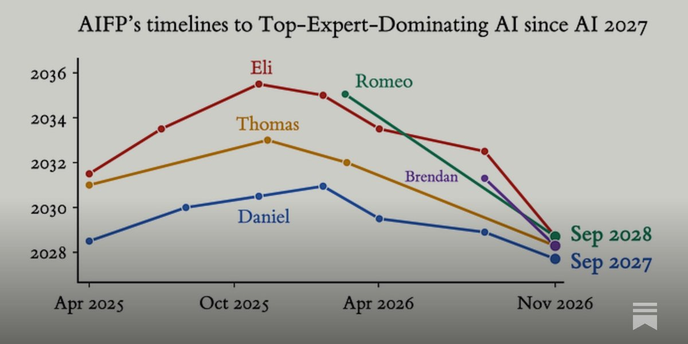

# AI Futures Project: "the intelligence explosion will happen in 2027 after all"

The authors of [[ai-2027]] pulled their forecasts forward in a 10 November 2026 update. All of them now expect a Superhuman AI Researcher (SAR) most likely in 2027, assuming no deliberate slowdown. The single biggest reason, they say, is METR's report on AI R&D acceleration at Anthropic ([[metr-anthropic-ai-rd-acceleration]]).

*AI Futures Project: each author's median forecast for Top-Expert-Dominating AI (TED-AI) since AI 2027.*

## Links

- **Post**: [Q3.5 Timelines Update: Looks Like the Intelligence Explosion Will Happen in 2027 After All](https://blog.aifutures.org/p/q35-timelines-update-looks-like-the), AI Futures Project, 10 Nov 2026
- **Daniel Kokotajlo's thread**: https://x.com/DKokotajlo/status/2120204075803500595
- **Buck Shlegeris (Redwood Research)**: https://x.com/bshlgrs/status/2120271165692461316
- **Coverage**: [Yahoo Tech](https://tech.yahoo.com/ai/articles/ai-futures-project-pulls-intelligence-110601953.html)
- **Companion posts**: [Verified compute allocation disclosures](https://blog.aifutures.org/p/verified-compute-allocation-disclosures); [Pacing AI via compute reallocation](https://blog.aifutures.org/p/pacing-ai-via-compute-reallocation)

## What they say

Kokotajlo on X:

> Unfortunately, it seems like the intelligence explosion will be happening in 2027 after all. … If they're right, that implies an AI-driven acceleration that is 5 months ahead of the AI 2027 scenario. I am scared, sad, and angry.

- **Headline**: SAR likely in 2027; a 35–65% chance of TED-AI before 2028.
- **Daniel Kokotajlo**: SAR median May 2027 (from December 2028 in August); TED-AI median September 2027.
- **Thomas Larsen**: TED-AI April 2028, from early 2032.
- **Eli Lifland and Romeo Dean**: TED-AI around September 2028.

## Why they moved

METR estimated Anthropic's progress at about twice its earlier rate, with perhaps 80% of that due to AI. The authors turn that into about a 1.7× AI-driven speed-up and feed it into their model, which before the report gave that level under a 4% chance. They flag two caveats: Anthropic redacted most of the evidence METR found most informative, and the speed-up may hold only for well-specified tasks.

Their conclusion: "If SAR is coming in 2027, it is incredibly urgent to pause or substantially 'pace' frontier AI development." Buck Shlegeris, separately, put about a one-in-three chance on AI companies building superintelligence within a year.

## See also

- [[ai-2027]]
- [[metr-anthropic-ai-rd-acceleration]]
- [[anthropic-roadshow-compute-multiplier-slide]]
- [[moc-ai-risk-warnings]]
