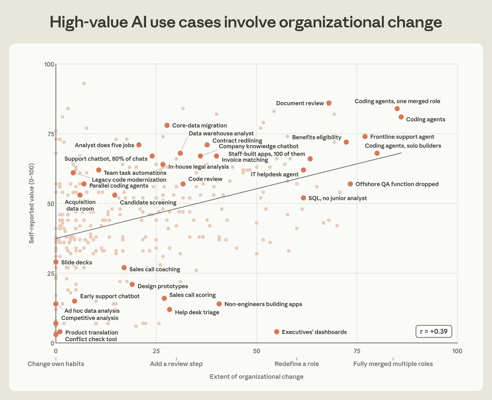

# Working with AI: the value comes from reorganising, and workers resist

**Anthropic's economics team interviewed 66 people at 58 US companies adopting AI. The most valuable uses came with real organisational change, and that same change drives worker resistance.**

## Links

- **Paper**: [Working with AI](https://www.anthropic.com/research/working-with-ai), Anthropic, 23 Nov 2026 ([PDF](https://assets.claude.com/0cb09418f04d09baf72922e53a3f17383ef838c9.pdf))
- **Authors**: Nathan Wilmers, Maxim Massenkoff, Peter McCrory (Anthropic Economics team)
- **Commentary**: [Ethan Mollick on X](https://x.com/emollick/status/2125098309928812898), 24 Nov 2026

## Overview

A qualitative study: 66 face-to-face interviews across 58 of Anthropic's enterprise customers in the US, from AI-native startups to century-old firms (law firms, hedge funds, dentists, accountants, a trucking company). The authors say the sample is not random or representative, and the value ratings are interviewees' own descriptions, not A/B tests.

Key findings:

- **Value comes from reorganising.** Across nearly 300 AI applications, self-reported value rises with the extent of organisational change (r = +0.39). Light-touch uses such as slide decks or ad hoc analysis rate low; the top uses merge or redefine roles, such as coding agents with one merged role.
- **More output, not lower costs.** Most uses add value by raising output: about half by speeding up existing work, half by better quality or new products. In about a tenth of cases the gain went straight to employees, as more enjoyable work or less work.
- **Few AI layoffs, less hiring.** Very few domestic layoffs driven by AI automation, but most companies report hiring less, and many cut contractors, especially offshore. The authors flag this as a possible early warning for international business services.
- **Resistance.** Top-down automation brings job insecurity, fear of surveillance, and resistance from the experts needed to make workflows work. Bottom-up "hand out tools and wait" gets uneven adoption.
- **What works.** Broadening roles so people own whole workflows, moving staff to the "bottleneck" tasks AI can't do, and giving non-developers coding infrastructure and access to business data.

## Ethan Mollick's take

Ethan Mollick (Wharton professor) on X, 24 Nov 2026:

> Two big points from this new Anthropic paper:
> 1) The most AI value comes from changing the organization
> 2) There is wide worker resistance to AI adoption (partially due to point 1)
>
> Changes that expand what workers do & share AI gains with them could help

## Why it matters

It is rare evidence from inside firms on how AI is actually being adopted, and it fits a pattern: handing out tools isn't enough, and the gains depend on redesigning work. It also says the real tension is not mass layoffs but reorganisation that workers have reason to fear, and less hiring, especially of contractors and offshore staff.

## See also

- [[hbr-ai-intensifies-work]]
