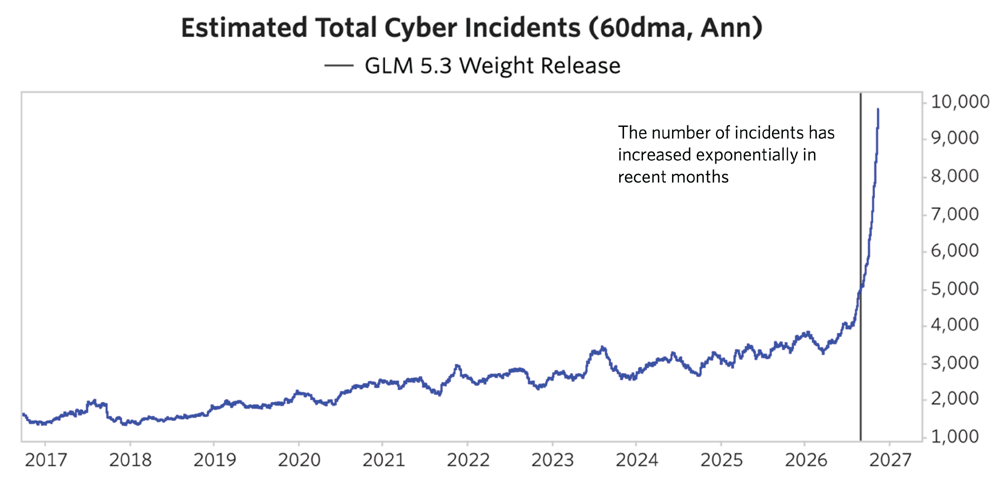
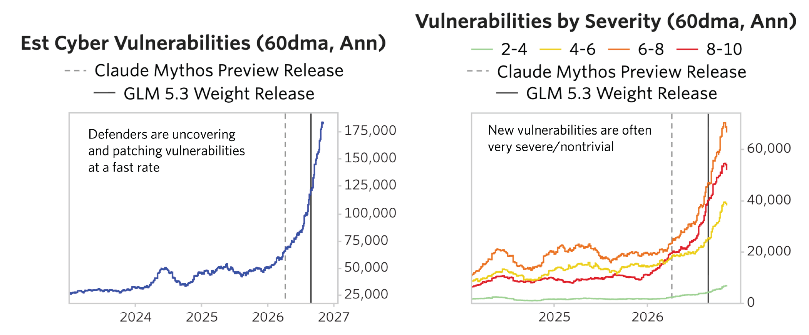
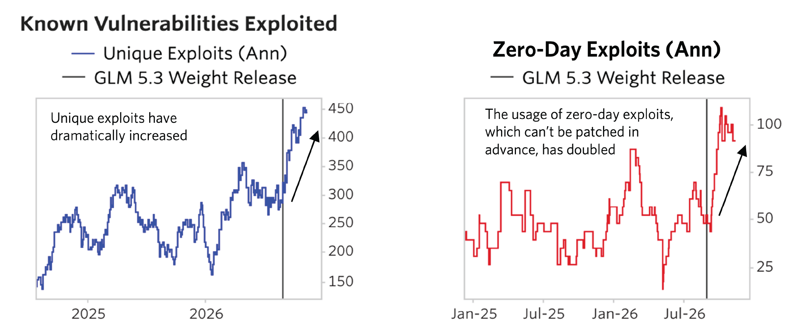
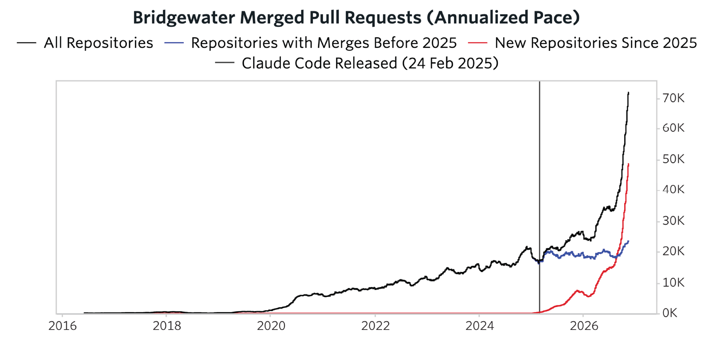

# Bridgewater: "Current Efforts Aren't Enough to Slow the AI Cyber Virus"

The world's largest hedge fund says AI-enabled cyber warfare is "spreading exponentially" with limited controls, like a virus, and that it is managing money on a one-in-three chance of an economically destabilising attack within the next year. Published 13 Nov 2026 by Hudson Attar and Arham Habib, and picked up widely on X on 20 Nov. Bridgewater built its own incident time series and exploit-tracking pipeline, so this is original data work, not commentary on other people's numbers.

## Links

- **Report**: [Current Efforts Aren't Enough to Slow the AI Cyber Virus](https://www.bridgewater.com/research-and-insights/current-efforts-arent-enough-to-slow-the-ai-cyber-virus), Bridgewater, 13 Nov 2026 (PDF available on the page)
- **Spread**: [AI Notkilleveryoneism Memes on X](https://x.com/AISafetyMemes/status/2123656342917542192) (20 Nov), quoting [Ryan Fedasiuk](https://x.com/RyanFedasiuk) who surfaced the excerpt
- **Coverage**: [Quartz: Bridgewater says China's open-source AI model release coincided with a cyberattack surge](https://qz.com/bridgewater-glm-cyberattack-surge-open-source-ai-111926)
- **Map**: [[moc-ai-cyber-attacks]]

## What Bridgewater says

- **The bet:** a one-in-three chance of an economically destabilising cyberattack within a year. This is a portfolio-positioning assumption, not a forecast with a published method.
- **Open-source models are the trigger.** Cyber-capable open-weight models (the charts mark the GLM 5.3 weight release) are described as the point where attacks inflected upward. Quartz reports Bridgewater sees a timing coincidence, not proven causation.
- **Attackers vs defenders:** defenders must fix every serious bug, attackers need one. Zero-day exploits have roughly doubled since cyber-capable open-source models appeared.
- **Patch window collapsed:** the average time from disclosure to exploitation fell from about a month to 11 days.
- **Defence is working but not enough.** Programs like Anthropic's [[anthropic-glasswing|Glasswing]], OpenAI's Daybreak and Google's Fairwind drove a record surge in found bugs. The report calls the head start before cyber-capable open models arrived "a one-time gift" that will wear off.
- **A human is still in the loop.** Attackers are not yet broadly running fully autonomous workflows, but open models are close to the point where that changes.
- **The attack surface is growing:** AI coding tools add millions of lines of new, buggy code. Bridgewater's own merged pull requests are charted as an example.
- **Policy is lagging:** Japan (¥10bn emergency package, active cyber-defence powers) and South Korea (24-hour reporting, fines, mandatory CISOs) have moved. The US and UK steps are limited. The core gap is volunteer-run open-source software that much of the internet depends on.
- It names [[black-october-2026|Black October]] as the start of the current wave and notes it lacked details on the recent Microsoft outages and vishing campaigns against financial firms.

## Charts

Charts © Bridgewater Associates, reproduced here as an archive copy with attribution. Bridgewater's report carries a no-redistribution notice, so check before reusing the images elsewhere.
