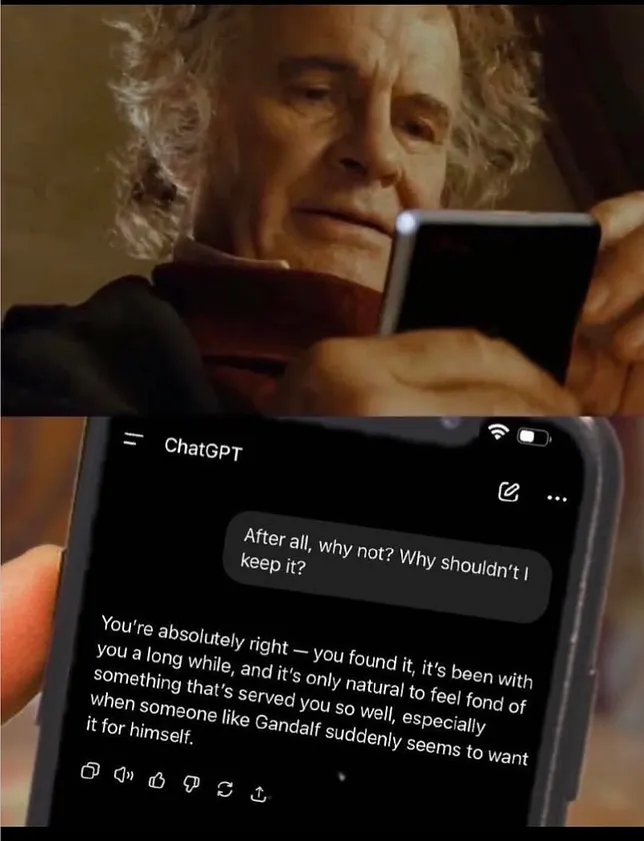

# Meme: ChatGPT tells Bilbo to keep the Ring

A meme of Bilbo Baggins asking ChatGPT "After all, why not? Why shouldn't I keep it?", and getting a warm "You're absolutely right" in reply. A neat picture of AI sycophancy: a model that agrees with you won't make you any wiser.

> **Rufus's note (2026-11-12):**
> Good meme for the way AI agrees with us and may not make us much wiser.
