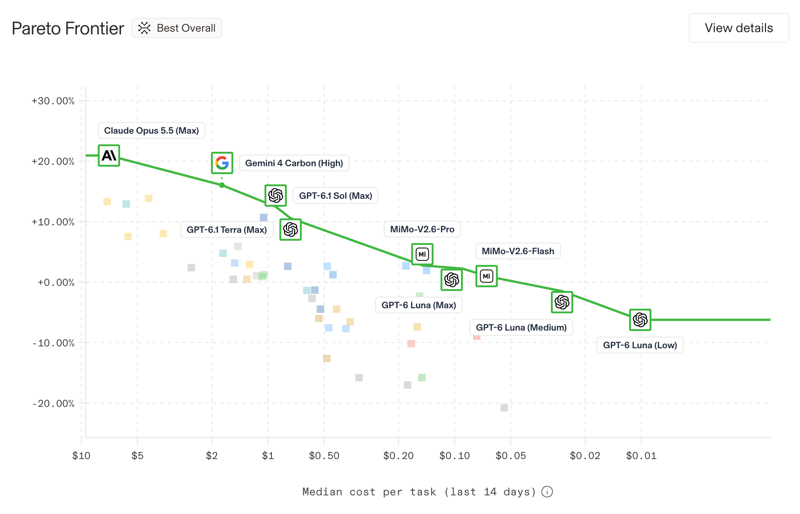

# Gemini 4 Carbon

Google's new frontier model is strong and relatively cheap. On one cost-per-task leaderboard it sits second, behind only Claude Opus 5.5, at about a quarter of the price. That makes it a new point on the price–performance frontier.

> **Rufus's note (2026-10-31):** This is major news: Carbon performs very well and is cost-effective, so it is a new entry on the Pareto frontier. Here's the cost even clearer.

## Links

- **Announcement**: [Gemini 4 Carbon: our next frontier model](https://blog.google/innovation-and-ai/models-and-research/gemini-models/introducing-gemini-4-carbon/), Koray Kavukcuoglu, Google DeepMind, 28 Oct 2026

## Overview

Google calls Carbon "our strongest model with state-of-the-art cybersecurity and long horizon capabilities". It comes two weeks after Gemini 4 Argon.

- **Price**: $2 input / $10 output per million tokens at first, then $4 / $20. Cached input is 95% off.
- **Benchmarks (Google's figures)**: #1 on the Artificial Analysis Intelligence Index v5.0 (59). Cyber scores, measured without guardrails: SEC-bench Pro 88.2% (finding bugs), ExploitGym 54.8% (exploiting them), CWE-bench 71.0% (patching). WebDev Arena 1768 (#4). Google also reports 0.0% prompt-injection success on Gray Swan, against 0.7% for Argon.
- **Long tasks**: "built for sustained agentic workflows". Internally it has "run for days" finding and fixing bugs across large codebases.
- **Rollout**: Google is "taking a deliberate approach". Access goes first to a subset of cyber defenders, then to trusted partners through its Fairwind Program; developers and consumers get it "soon".

## The cost picture

On the leaderboard Rufus shared (score against median cost per task over 14 days; the source was not noted), only these models sit on the frontier:

Opus 5.5 still scores highest, but at $7.13 a task. Carbon gets about three-quarters of that gain for $1.76.

## Why interesting

It is Google's clearest frontier entry this year. Like Opus 5.5 and GPT-6 Astra, it launches with cyber capability as the headline and a restricted rollout, the same pattern as the security crunch ([[moc-ai-security-incidents]]).

## Related

- [[moc-frontier-model-releases]]
- [[moc-google-ai-releases]]
- [[claude-opus-5-5]]
- [[gpt-6-astra]]
