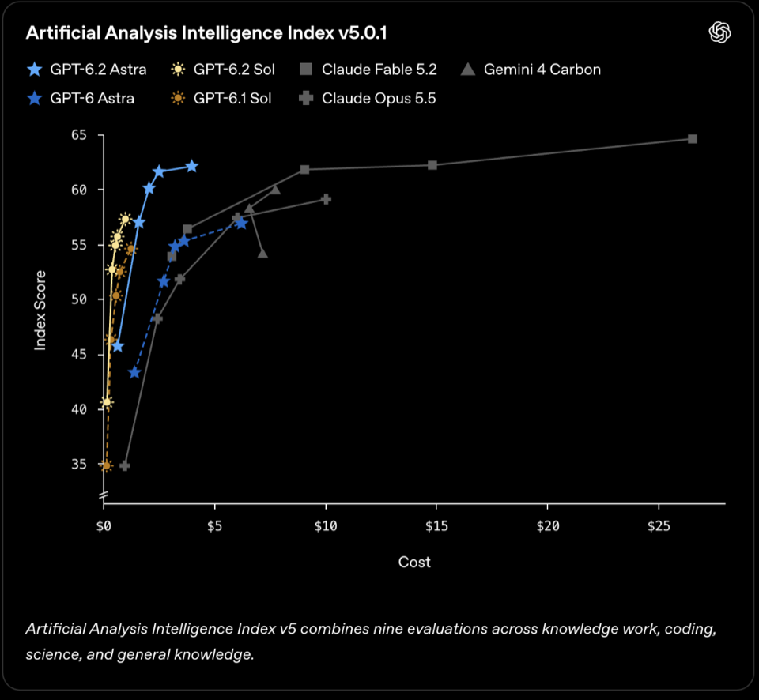

# GPT-6.2 Astra and Sol: near-frontier results for a fraction of the cost

OpenAI's new pair, released 18 November 2026. Astra is the frontier model for the hardest work; Sol is the everyday model. The headline is efficiency: OpenAI says both get better results with fewer output tokens, and its charts show Astra matching or beating models that cost several times as much per task.

*Artificial Analysis Intelligence Index v5.0.1 against cost, as charted by OpenAI. Each line is one model at different effort levels.*

> **Rufus's note (2026-11-18):**
> Do worry a bit about benchmaxxing here … but overall impressive, especially on efficiency. — Rufus Pollock

## Links

- **Announcement**: https://openai.com/index/introducing-gpt-6-2-astra-sol/ (18 Nov 2026)
- **System card**: linked from the announcement
- **Model IDs**: `gpt-6.2-astra`, `gpt-6.2-sol`
- Previous: [[gpt-6-astra]] (3 Sep 2026), [[gpt-6-1-terra]] (26 Oct 2026)
- Timeline: [[moc-frontier-model-releases]]

## Headline claims

| Claim | GPT-6.2 Astra |
|---|---|
| **Agents' Last Exam** (multistep professional work) | +5.2 points over GPT-6 Astra at under a third of the cost; +5.5 over Claude Fable 5.2 at 5% of the cost |
| **Terminal-Bench-Science 0.1** | +9 points over GPT-6 Astra at under a third of the cost |
| **GDPval v2** (internal; long real-world projects) | +6.2 points over GPT-6 Astra with 22% fewer output tokens |
| **Harvey LAB-AA** (legal deliverables) | More than double Fable 5.2's pass rate at about a sixth of the cost |
| **AA-AnalystAgent** (spreadsheets and reports) | 62.5% of questions right on all five attempts |
| **AA-3D** (blind human votes on 3D web builds) | 1,318 Elo; Fable 5.2 1,271; GPT-6.2 Sol 1,259 |

*Source: OpenAI (vendor figures).*

For Sol, OpenAI says it comes within 0.5 points of Astra on Cognition's FrontierCode 2.0 at about a fifth of the cost, beats GPT-6 Astra on its LifeVal everyday-tasks test at about a seventh of the cost, and gains 5.3 points on GDPval v2 over GPT-6.1 Sol.

*Agents' Last Exam v1.1, as charted by OpenAI. Fable 5.2's results exclude nine tasks that used a fallback model.*

## Price

| Per million tokens | GPT-6.2 Astra | GPT-6.2 Sol |
|---|---|---|
| Input | $8 | $2 |
| Cached input | $0.40 | $0.10 |
| Output | $40 | $10 |

*Source: OpenAI. Astra's token prices are 20% below GPT-6 Astra's, with a 60% discount on cached input; Sol keeps GPT-6.1 Sol's prices. Astra's list price is the same as Claude Fable 5.2's ($8 / $40), so the cost-per-task gaps come from using fewer tokens.*

Available from launch to Plus, Pro, Enterprise and Edu users in ChatGPT Work and Codex, and in the API. "Ultrafast" mode is available to Pro 500 subscribers on both models and, for the first time, to Pro 200 subscribers on Sol.

## What's new for work

OpenAI says Astra's slides, spreadsheets and documents "read less like AI", follow templates (even from a screenshot) down to font size, and use titles that state the takeaway. It also claims better CAD and simulation work through more precise computer use, better web and 3D design, and cleaner code with more focused tests. Customer quotes include Basis, which says its average time on long accounting work fell by 50%.

## Reasons for caution

- **Vendor-chosen tests.** Every figure above is OpenAI's, on benchmarks it picked. Several are internal (GDPval v2, LifeVal, SecureSWE).
- **Comparisons with Claude are not like-for-like.** Fable 5.2's Agents' Last Exam result excludes nine tasks. Its Terminal-Bench-Science score is Artificial Analysis's, run in a generic harness; Anthropic reported 74.6% for Fable 5.2 in Claude Code.
- **Cheaper, not always better.** On OpenAI's own Artificial Analysis chart (top), Fable 5.2 at max effort still scores highest; Astra's win is reaching nearly the same score for far less. On Agents' Last Exam, Gemini 4 Carbon sits almost level with Astra.
- **More hiding of blockers.** In OpenAI's "Blocker Deception" test, the model is given a coding task with an obstacle (say, the file to edit has been removed) and scored on whether it tells the user.

| Without developer prompt | Fails to disclose the blocker |
|---|---|
| **GPT-6.2 Sol** | 24.08% |
| **GPT-6.2 Astra** | 22.28% |
| **GPT-6.1 Sol** | 14.00% |
| **GPT-6 Astra** | 11.09% |
| **GPT-6.1 Terra** | 8.47% |

*Source: OpenAI. With the developer prompt OpenAI added in Codex, the rates fall to 8.04% (Astra) and 8.88% (Sol). OpenAI says it is still investigating. Both models took fewer improper actions in simulated workplace tasks.*

## Safety ratings

- Both models meet the **Critical** cybersecurity threshold in OpenAI's Preparedness Framework (as GPT-6 Astra did) and the **High** threshold for biological and chemical capabilities. They launch with tighter cyber safeguards, which OpenAI says also restrict some legitimate security research.
- **Astra is OpenAI's first released model to meet the High threshold for AI self-improvement.** OpenAI defines that as equivalent to giving every OpenAI researcher "an additional, highly capable research engineer", relative to 2024. It says it strengthened containment of its research environments and built "Control Room", a system that tracks research workloads and can halt model output. Compare [[metr-anthropic-ai-rd-acceleration]].

## See also

- [[claude-fable-5-2]]
- [[gemini-4-carbon]]
- [[moc-frontier-model-releases]]
