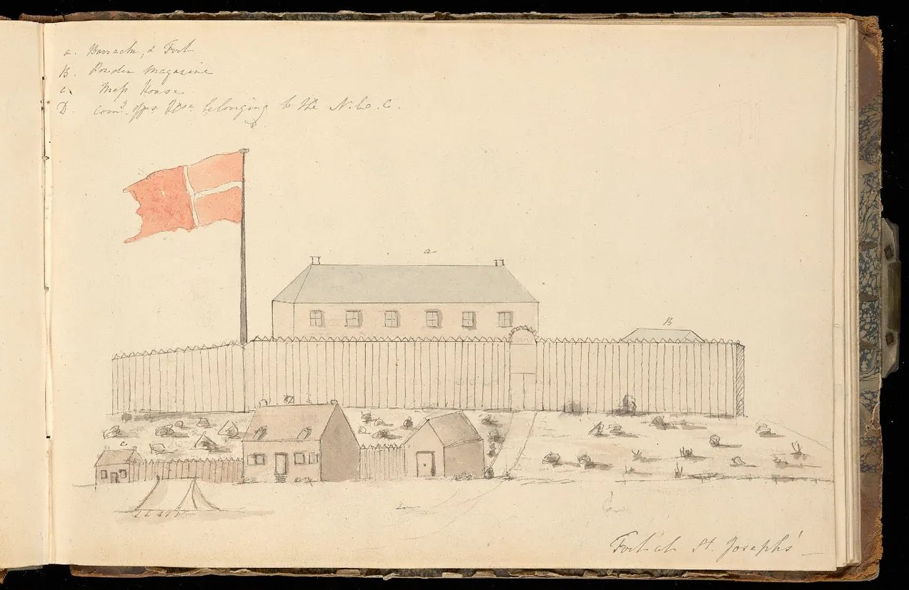

# GPT-6.2 Astra makes a historical discovery: what happened to maths is reaching history

**Historian Mark Humphries says GPT-6.2 Astra, in 22 minutes, identified the unknown artist of an 1808 fur-trade sketchbook and found a forgotten diary that proved it.**

> **Rufus's note (2026-11-24):**  
> Important point about what happened to maths now happening to history.

## Links

- **Post**: [Generative History: GPT-6.2 Astra solves a historical mystery](https://generativehistory.substack.com/p/gpt-62-astra-solves-a-historical)
- **Thread**: [Mark Humphries on X](https://x.com/HistoryGPT/status/2125213218045858149), 24 Nov 2026

## What happened

Yale's Beinecke Library holds an anonymous sketchbook of an 1808 journey from Montreal to Lake Superior, with only four dated and labelled images. Humphries had tried for years to find the artist. With minimal prompting, Astra named the vicomte de Chabot, a minor French aristocrat, and suggested ordering a little-known microfilmed diary of his trip. The scans matched: same handwriting, same itinerary, and on 18 June 1808 Chabot wrote that he "took a sketch" of the exact view of Fort St. Joseph in the book.

The 162-page journal is itself a significant new source for fur-trade history, and came with excerpts from long-destroyed North West Company papers. Humphries says he "basically acted as the research assistant".

## Why it matters

Humphries argues that discovery in checkable fields like maths is starting to spread to fields without a clean right answer. He puts historians where mathematicians were about eleven months ago, when LLMs began solving Erdős problems.

## See also

- [[ai-and-mathematics]]
- [[gpt-6-2-astra-sol]]
