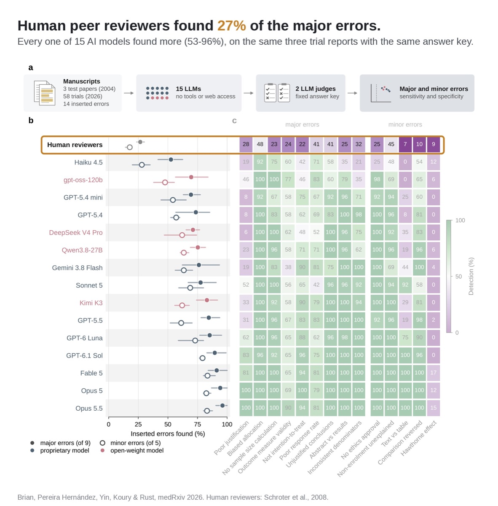

# AI models find the errors human peer reviewers miss

Human peer reviewers found 27% of the major errors planted in three trial reports. All 15 AI models tested found more, from 53% to 96%.

## Links

- **Preprint**: [Large language models detect methodological errors that human peer review misses in clinical trials](https://www.medrxiv.org/content/10.64898/2026.10.25.26366455v2), medRxiv, 28 Oct 2026
- **X summary**: https://x.com/i/trending/2115860808865587425 ("AI Outspots Human Errors in Science Reviews But Quietly Shapes Judgments")

## Overview

The human baseline is a 2008 study (Schroter et al.) that planted errors in three randomised trial reports and sent them to reviewers. They found 27% of the major errors on average. The authors gave the same three reports to 15 models with no tools or web access, then scored the reviews with two AI judges and a fixed answer key.

- **Original reports**: models found 53% to 96% of major errors.
- **New trials**: to rule out memorisation, they repeated it on 58 trials published in 2026. Models found 58% to 99%; open-weight models 66% to 89%.
- **Best**: Opus 5.5, at 99% on the 2026 trials. GPT-6.1 Sol (94%) and GPT-6 Luna (86%) are named as cheaper options.
- **Speed**: 1.4 to 16 minutes per review, against the 5 to 8.5 hours human reviewers report.
- **False alarms**: on unmodified reports, models still flagged 14% to 29% of the error types, most often "conclusions not supported by results".

The authors' caveats: the human comparison is historical, and no humans reviewed the 2026 trials. AI judges scored the reviews. Four of the five authors work with ResearchHub Foundation, which is building AI-assisted review.

## Why interesting

It is a clean before-and-after: the same papers and answer key, people in 2008 and models in 2026. Even the weakest model doubled the humans' score. Read it next to Anthropic's study the same week ([[anthropic-agents-judgment-calls]]): AI is now better than experts at catching errors, and also good at steering what experts decide.

## Related

- [[anthropic-agents-judgment-calls]]
- [[claude-opus-5-5]]
