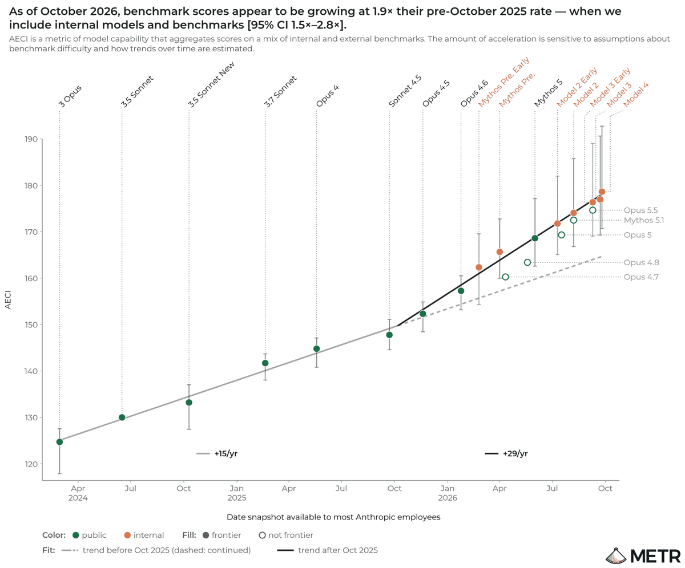

# METR: Anthropic's AI progress has roughly doubled in speed

METR, the independent evaluator, spent 11 weeks inside Anthropic with access to non-public data. It concludes that Anthropic's models are improving at about twice the rate they did from March 2024 to October 2025. Its rough guess is that most of that speed-up comes from AI doing the work.

*METR: Anthropic's internal capability index (AECI) by model, with the October 2025 breakpoint.*

## Links

- **Report**: [Independent Assessment of AI R&D Acceleration at Anthropic in October 2026](https://metr.org/blog/2026-11-05-anthropic-ai-rd-acceleration-assessment/), METR, 5 Nov 2026
- **Companion review**: [Review of the "Risks from automated R&D" section in Anthropic's Risk Report](https://metr.org/blog/2026-11-05-rd-section-anthropic-risk-report-august-2026-review/), METR, 5 Nov 2026
- **The method, proposed in advance**: [How an assessor could investigate evidence of acceleration from the automation of AI R&D](https://metr.org/blog/2026-10-14-ai-rd-acceleration-assessment-proposal/), METR, 14 Oct 2026
- **News coverage**: [Associated Press](https://apnews.com/article/anthropic-metr-ai-claude-acceleration-9cf8c590ffc1abdb489179bdccc69c23), 5 Nov 2026

## Overview

This is the first time an outside body has checked, with inside access, whether a frontier lab is speeding itself up with its own AI. That loop, AI improving the AI, is the core mechanism in [[ai-2027]] and in most fast-takeoff worries. Until now the evidence was the labs' own word.

METR's answer is yes, probably, by about 2×:

> Since October 2025, benchmark scores for internal models have been growing at around twice their historical rate.

## Key numbers

| Measure | Estimate |
|---|---|
| **Growth in Anthropic's capability index since Oct 2025** | 1.9× the earlier rate (95% CI 1.5–2.8×) |
| **Plausible range METR gives** | 1.3× to 3× |
| **Share of the speed-up due to AI (rough guess)** | about 80%, highly uncertain |
| **Same measure, all frontier developers** | about 1.4× |
| **Anthropic's own estimate (Haiku 5.5 system card)** | 1.7× |
| **Staff self-reported uplift from the best internal model** | about 12× |

*Source: METR, 5 Nov 2026. Some robustness figures come from the later part of a long report and are less certain.*

The index trend goes from about 15 points a year before October 2025 to about 29 after. METR is "confident that the acceleration was not due to an acceleration in the scaling of training compute". It also found no convincing bottleneck that would stop the trend over the next 12 months.

## Method

METR had Anthropic's internal benchmark scores, including for unreleased models, plus training metrics, headcount, inference spend, staff surveys and about 15 interviews. It fitted a capability index across models and compared growth before and after a single breakpoint. It then attributed the change by counterfactual reasoning and interviews. The engagement ran from August to October 2026 with about 2.5 full-time staff.

## Caveats METR states

- **Redactions**: "Anthropic redacted a majority of the evidence we found most informative for these conclusions." METR says the public report does not achieve "transparency about evidence".
- **Sensitivity**: the estimate moves a lot with modelling choices, from about 1.1× to 2.9×.
- **Benchmarks may not be reality**: benchmark scores are saturating, and faster benchmark growth may not mean faster real-world impact.
- **Limited access**: METR could not query unreleased models itself.
- **Could be lower**: METR's own report sets out how non-AI factors could explain most of the speed-up.

## Why interesting

Two of this week's stories fit together. METR measures the loop speeding up at Anthropic, and four days later Anthropic released [[claude-fable-5-2]], a large jump in long-running agentic work ten weeks after Fable 5.1. Anthropic now says over 90% of the code changes merged into its core codebase are written by Claude.

It also matters as a precedent: a lab let an outside evaluator in to test the claim that worries people most. The redactions show how far that still is from public accountability.

## Related

- [[ai-2027]]
- [[anthropic-recursive-self-improvement]]
- [[claude-fable-5-2]]
- [[elizabeth-barnes-we-are-not-on-top-of-it]]: METR's founder on how far oversight lags
- [[pacing-the-frontier]]
- [[moc-ai-risk-warnings]]
