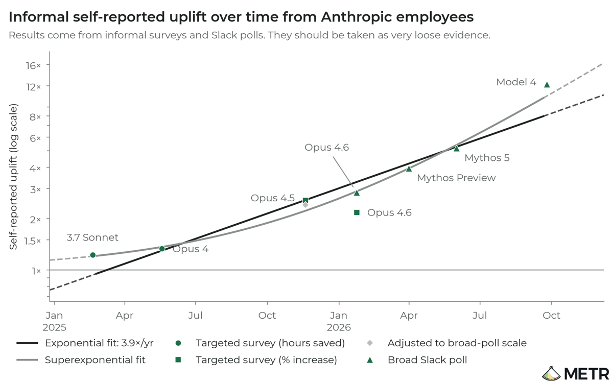
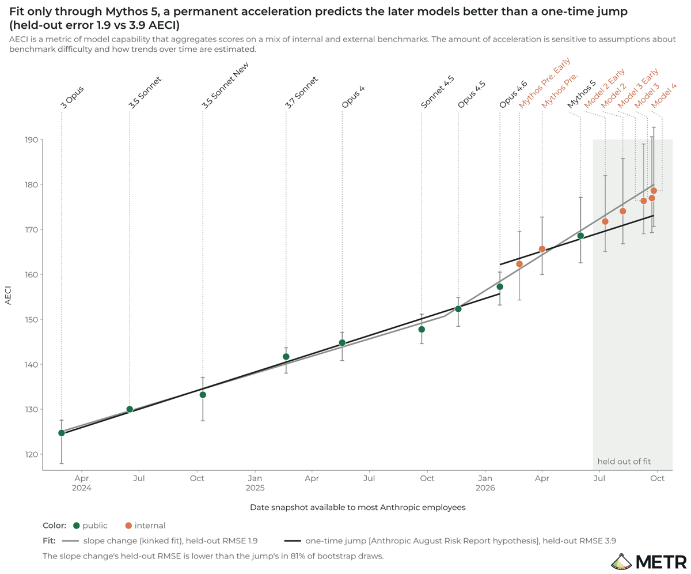

# METR: AI is roughly doubling the speed of AI progress at Anthropic

METR, the independent AI evaluator, spent 11 weeks inside Anthropic with unprecedented access to internal data. It concludes that Anthropic is now improving its models at about **twice** the rate it did from March 2024 to October 2025, and guesses that about 80% of that speed-up comes from AI doing the work. It found no bottleneck that would stop the speed-up compounding over the next year.

*METR: Anthropic's benchmark index has grown at 1.9× its pre-October 2025 rate. Orange dots are internal models the public has not seen.*

## Links

- **Report**: [Independent Assessment of AI R&D Acceleration at Anthropic in October 2026](https://metr.org/blog/2026-11-05-anthropic-ai-rd-acceleration-assessment/), METR, 5 Nov 2026
- **Companion**: [Review of the "Risks from automated R&D" section in Anthropic's Risk Report (August 2026)](https://metr.org/blog/2026-11-05-rd-section-anthropic-risk-report-august-2026-review/), METR, 5 Nov 2026
- **The questions it set out to answer**: [How an assessor could investigate evidence of acceleration from the automation of AI R&D](https://metr.org/blog/2026-10-14-ai-rd-acceleration-assessment-proposal/), METR, 14 Oct 2026
- **News coverage**: [Associated Press](https://apnews.com/article/anthropic-metr-ai-claude-acceleration-9cf8c590ffc1abdb489179bdccc69c23), 5 Nov 2026

## Why it matters

AI speeding up AI research is the mechanism behind every fast-takeoff worry, from I.J. Good in 1965 to [[ai-2027]]. Until now the evidence was the labs' own word. This is the first time an outside evaluator, with inside access, has checked. METR states the stakes in its first paragraph:

> If AI systems started to significantly accelerate further AI development, this could lead to a sudden emergence of extreme and risky capabilities.

Its answer is that the loop is running, at Anthropic at least, and that nothing METR could see will slow it soon.

## The three conclusions

In METR's own words:

> As of October 2026, Anthropic is likely improving the capabilities of their models on well-specified tasks at around twice the rate they did between March 2024 and October 2025. This estimate is given with high uncertainty; we would not be surprised if the true acceleration was closer to 1.3x or 3x the historical rate.

> A majority of this acceleration today is likely attributable to Anthropic's extensive use of AI to do R&D, though there is significant uncertainty and other causes likely played a large role in acceleration in late 2025.

> The lack of observed bottlenecks or strong diminishing returns means there is a significant risk that further capabilities progress could lead to even faster acceleration, though, as we say below, we may be missing important bottlenecks.

A 2× acceleration means two years of earlier-rate progress in one year. METR puts it plainly: Anthropic "appears to have made as much progress on benchmarks in the past year as they did between October 2023 and October 2025 (roughly, Claude 2.1 to Sonnet 4.5)".

## Key numbers

| Measure | Estimate |
|---|---|
| **Growth in Anthropic's capability index (AECI) since Oct 2025** | 1.9× the earlier rate (95% CI 1.5–2.8×) |
| **Range across METR's robustness checks** | 1.1× to 2.9× |
| **Same measure across all frontier developers** | 1.4× |
| **Anthropic's own estimate (Haiku 5.5 system card)** | 1.7× |
| **Share of today's acceleration due to AI (METR's guess)** | about 80% |
| **Staff self-reported uplift from the best internal model** | about 12× |

*Source: METR, 5 Nov 2026. AECI is Anthropic's version of Epoch AI's Capabilities Index, which combines many benchmarks into one score.*

METR's estimate is higher than Anthropic's 1.7× because it includes Anthropic's newest **internal-only** models, called Model 2, 3 and 4 in the report. They finished training between July and October 2026 and sit above every public Claude model on the chart. METR notes that Anthropic "is holding onto more recent models for slightly longer before their public release".

## Is it AI, or something else?

METR is "confident that the acceleration was not due to an acceleration in the scaling of training compute." Beyond that it relied on interviews, surveys and internal analysis, much of it redacted. Its sketch of the attribution is labelled "fake data":

*METR's illustration of how it splits the speed-up between AI and other causes. Not real data.*

The staff surveys are the most striking evidence, and METR treats them as the weakest. Self-reported uplift from Anthropic's own models went from about 1.2× (Claude 3.7 Sonnet, early 2025) to about 12× (Model 4, October 2026).

*METR: "Results come from informal surveys and Slack polls. They should be taken as very loose evidence."*

METR stresses that a 12× personal speed-up does not mean 12× faster progress. Labour is one input among many, and progress faces diminishing returns.

### What Anthropic researchers told METR

METR publishes the interview quotes, with sensitive details redacted. Of 11 researchers, five supported or leaned towards a 2× or greater speed-up, four were unclear, and two said no.

> "Now only bottlenecked on ideas & compute, no longer bottlenecked on code." (Researcher A)

> "It is hard to see how I am not being 3x more productive. I feel like I have postdocs and grad students, and we are working towards a larger project." (Researcher B)

> "Experimentation overhead is driven towards zero super fast." (Researcher C)

> "I've seen us discovering very promising directions ~entirely because people can spam 10 ideas at [agent-scaffold] and see what sticks." (Researcher E)

The sceptics put more weight on hiring:

> "Guesses 15-20% is due to AI. Don't believe in self-reported productivity increase." (Researcher L)

Several researchers describe the same sequence. One summarises it: Opus 4.5 was the "first time useful for autonomous code", and Mythos Preview with an agent scaffold was the "first time useful for autonomous experiment". METR adds that AI cannot yet make "highly significant and fully autonomous contributions" to model training, but researchers describe "signs of life".

## A step change, or a new slope?

Anthropic's own August risk report suggested a one-time jump at Mythos Preview, followed by a return to the old trend. METR tested this by fitting both stories to the models up to Mythos 5 and checking which better predicted the later internal models. The new slope won, with half the error.

*METR: "a permanent acceleration predicts the later models better than a one-time jump". The slope change wins in 81% of bootstrap draws.*

## Caveats METR states

**Acceleration could be higher.** Growth could itself be speeding up ("hyperbolic"), and Anthropic redacted evidence pointing that way. Automation of research could be close. And benchmarks may understate real-world impact. METR notes that math benchmark scores have not accelerated much, "but we are now seeing the resolution of Millennium Prize Problems that have evaded decades of human effort."

**Acceleration could be lower.** Non-AI factors such as hiring could explain most of it. Gains may be limited to clean, easily graded tasks. And Anthropic's earlier growth may have been unusually slow, because it lagged the wider frontier before late 2025. Measured across all developers, the speed-up is 1.4×:

*METR: across all frontier developers, 1.4×. Other labs' internal models are not visible.*

**Benchmarks are running out.** Anthropic's newest internal model scores above 50% on every benchmark it was tested on. METR says this "makes us somewhat nervous about our ability to measure AECI now and in the future."

## What the public cannot see

The report is as notable for its process as its findings. Anthropic had unilateral rights to redact anything non-public, and used them heavily:

> While we were able to freely share our highest-level conclusions about risk, Anthropic redacted a majority of the evidence we found most informative for these conclusions.

> As a consequence, the public has to rely on METR's judgment much more than would be ideal, given the weight of the questions answered here.

Anthropic said the redactions were "aimed at removing confidential information that could accelerate other AI developers." METR agrees they were limited to that kind of information. It does not say whether they were justified. Anthropic tightened its redaction guidance in the last week, and the deadline moved back about five days.

Other process details:

- **Compute check dropped.** The contract originally included verifying how Anthropic splits compute between capabilities and safety. Anthropic cut that part midway, before METR reached any conclusion.
- **Claude in the loop.** Claude was deeply involved in most of the data METR received, a significant share of the documents, and most of METR's own analysis. METR found no sign this biased the results.
- **No payment.** METR took no fee; Anthropic provided laptops and token credits.
- **Not misled.** METR thinks it "extremely unlikely Anthropic was actively trying to mislead us".

## Why interesting

- **It pairs with Fable 5.2.** Four days later Anthropic released [[claude-fable-5-2]], a large jump in long-running agentic work ten weeks after Fable 5.1. Anthropic says over 90% of the code changes merged into its core codebase are now written by Claude.
- **The best models are internal.** Three Anthropic models stronger than anything public were in use internally by October.
- **A precedent with limits.** A frontier lab let an outside evaluator test the claim that worries people most. The redactions show how far that still is from public accountability.

## Related

- [[ai-2027]]: the scenario built on exactly this loop
- [[anthropic-recursive-self-improvement]]
- [[claude-fable-5-2]]
- [[ij-good-speculations-ultraintelligent-machine]]: the 1965 origin of the idea
- [[elizabeth-barnes-we-are-not-on-top-of-it]]: METR's founder on how far oversight lags
- [[pacing-the-frontier]]
- [[moc-ai-risk-warnings]]
