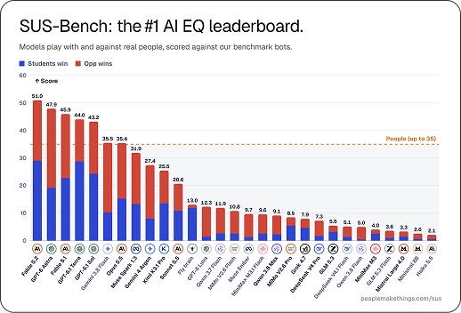

# SUS-Bench: AI models beat people at a Mafia-style game

A leaderboard from a 10-player social-deduction game (like Mafia or Among Us) where AI models play with and against real people, nobody knowing who is who. The top five models score above the best people.

> **Rufus's note (2026-11-14):**
> AI playing against humans at Mafia: the latest models beat humans.

*The game: A Mog School (amogschool.com).*

## Links

- **Leaderboard and method**: https://peoplemakethings.com/sus
- **Announcement**: https://x.com/imodarressi/status/2121280505786110176 (13 Nov 2026)
- **The game**: https://amogschool.com

## How it works

Each game has 2 hidden "Opps" (impostors) and 8 "Students". About half the seats are AI. The makers say more than 250,000 people from 167 countries have played over 500,000 rounds, unpaid. A model's score is the average of its win rates as Student and as Opp against the makers' benchmark bots; "people reach up to 35" on the same scale.

| Model | Score |
|---|---|
| **Claude Fable 5.2** | 51.0 |
| **GPT-6 Astra** | 47.9 |
| **Claude Fable 5.1** | 45.9 |
| **GPT-6.1 Terra** | 44.0 |
| **GPT-6.1 Sol** | 43.2 |
| **Claude Opus 5.5** | 35.4 |

*Source: SUS-Bench, 18 Nov 2026. Fable 5.2's score is marked as an early estimate from about a dozen games.*

The announcement labels OpenAI's models "maniac LIARS" and Anthropic's the "biggest SNITCH".

## Caveats

Self-published, not peer-reviewed, scored against the team's own bots, and noisy. Early scores blend signs of good play with actual wins. Calling it an "EQ" leaderboard is the makers' framing; what it measures is skill at a game of persuasion and deception.

## See also

- [[moc-frontier-model-releases]]
